

# کارتابل — دموی محصول

**کارتابل** سامانه مدیریت کار تیمی و اتوماسیون اداری است؛ فارسی، راست‌به‌چپ، با تقویم شمسی و ربات بله.

> این مخزن **فقط نمایش محصول** است: تصاویر و یک صفحه معرفی تعاملی.
> **کد منبع برنامه در این مخزن نیست.** © همه حقوق محفوظ است.

**دیدن دمو:** فایل `index.html` را در مرورگر باز کنید، یا نشانی GitHub Pages همین مخزن را ببینید.

  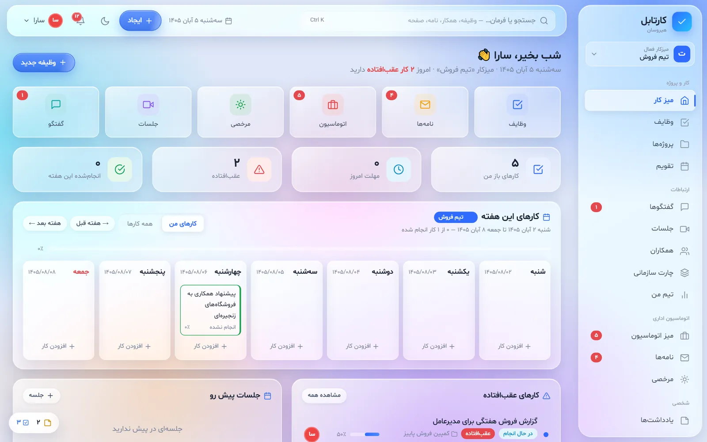

## قابلیت‌ها

| | |
|---|---|
| **وظایف و پروژه‌ها** | فهرست، کانبان و تقویم؛ وظیفه سریع، زیرکار، مهلت شمسی، تیک انجام با یک کلیک |
| **اتوماسیون اداری** | درخواست‌ها با تایید چندمرحله‌ای و کارتابل تایید |
| **نامه‌ها** | پیش‌نویس، امضا و ارسال؛ ارجاع و رونوشت، بایگانی و چاپ |
| **مرخصی** | درخواست و تایید مدیر، از وب یا ربات بله |
| **جلسات** | دعوت، دستور جلسه، صورتجلسه و تبدیل مصوبه به وظیفه؛ جلسه آنلاین |
| **گفتگو** | پیام‌رسان داخلی لحظه‌ای، فردی و گروهی |
| **چارت سازمانی و تیم من** | ساختار سازمان و بار کاری هر نفر |
| **ربات بله** | اعلان، تایید درخواست، مرخصی، نامه و ورود با کد یک‌بارمصرف |
| **جستجو و فرمان** | با Ctrl+K هر وظیفه، همکار، نامه یا صفحه را پیدا کنید |
| **روی صفحه** ✨ | یادداشت‌ها و کارهای امروز همیشه گوشه صفحه؛ تبدیل یادداشت به وظیفه و ارسال برای همکار؛ قابل خاموش کردن برای هر نفر |
| **شیشه مایع** ✨ | ظاهری الهام‌گرفته از Liquid Glass در iOS، کنار تم روشن و تیره |

## تصاویر

  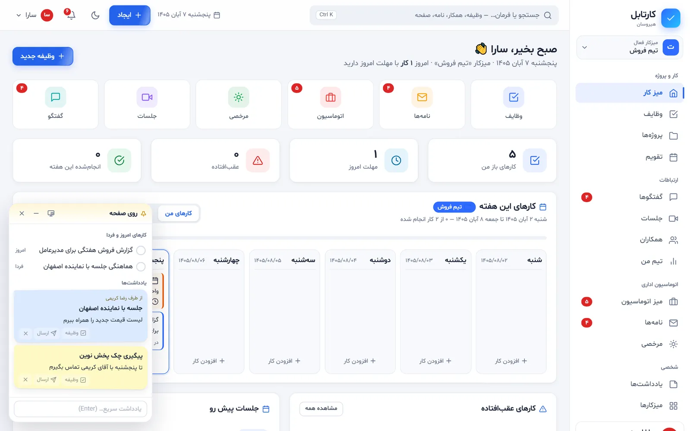
  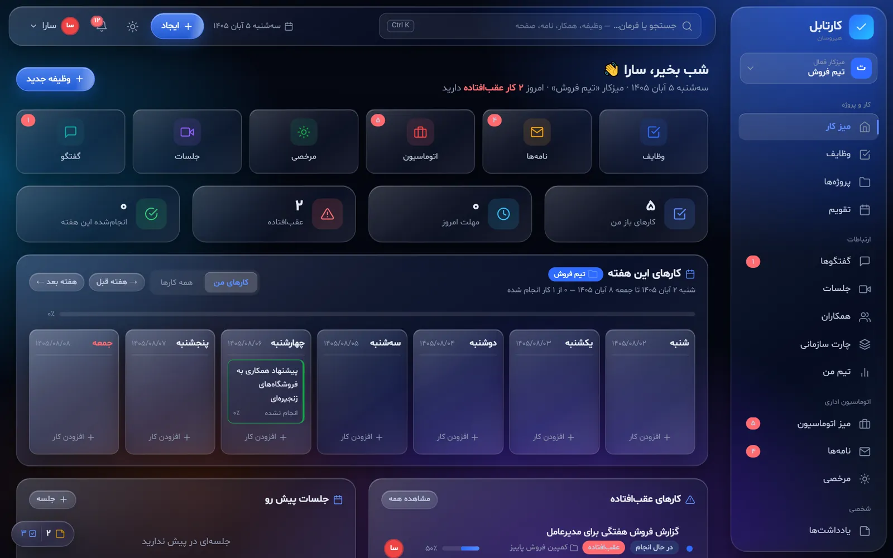
  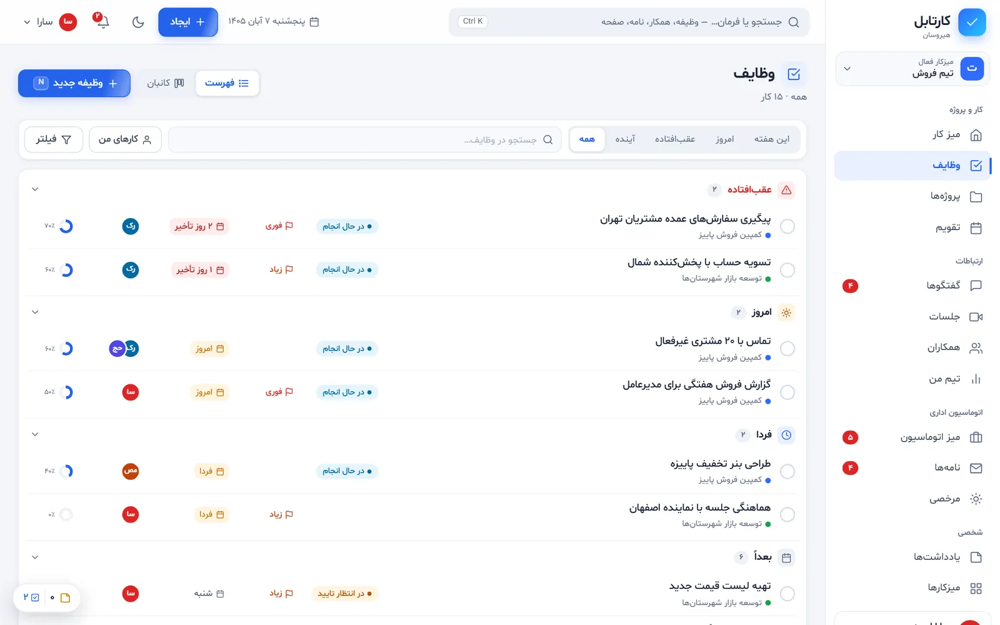
  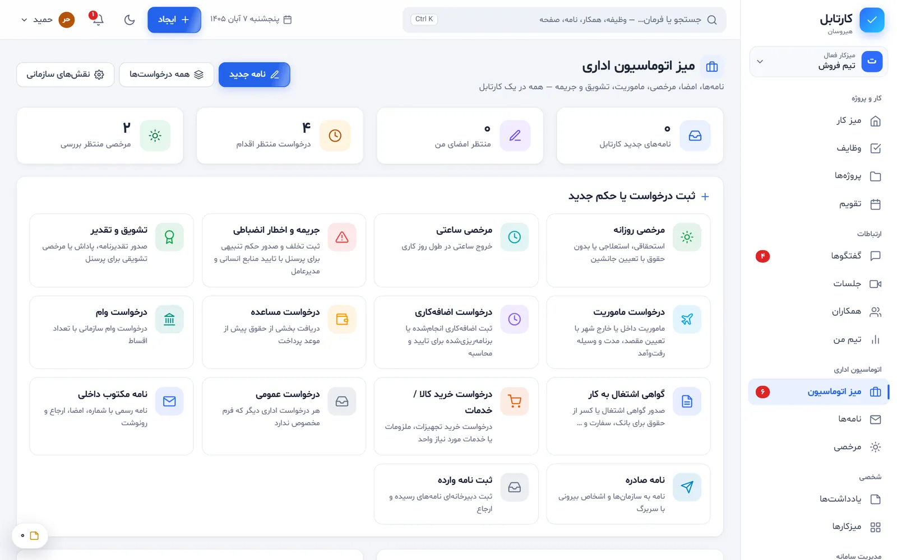
  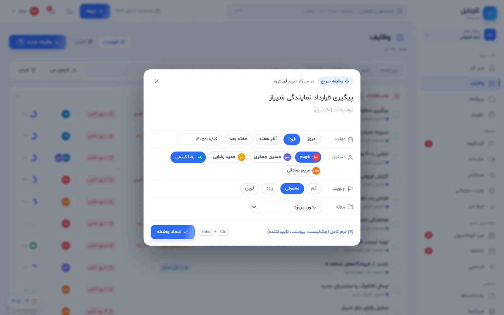
  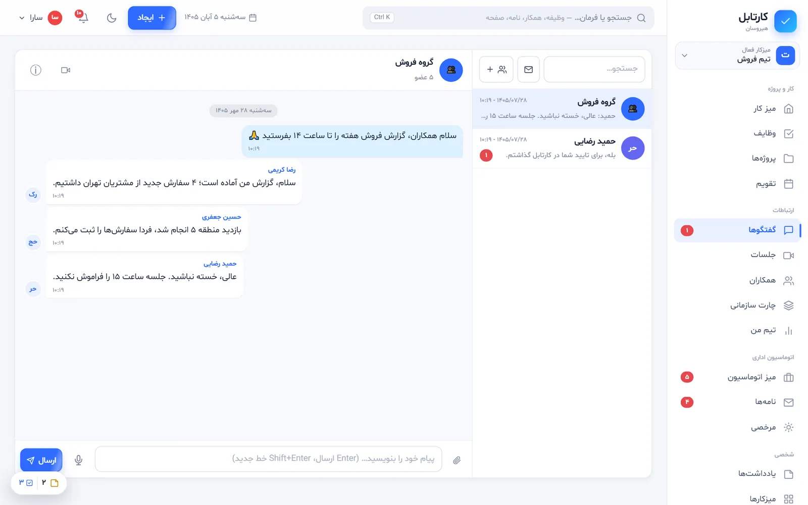

  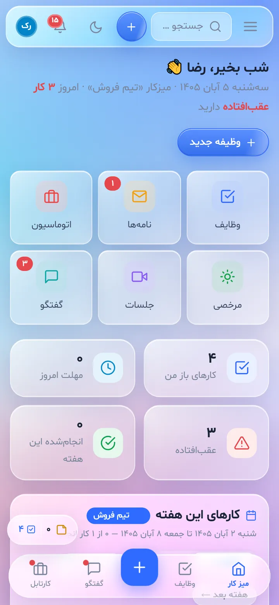
  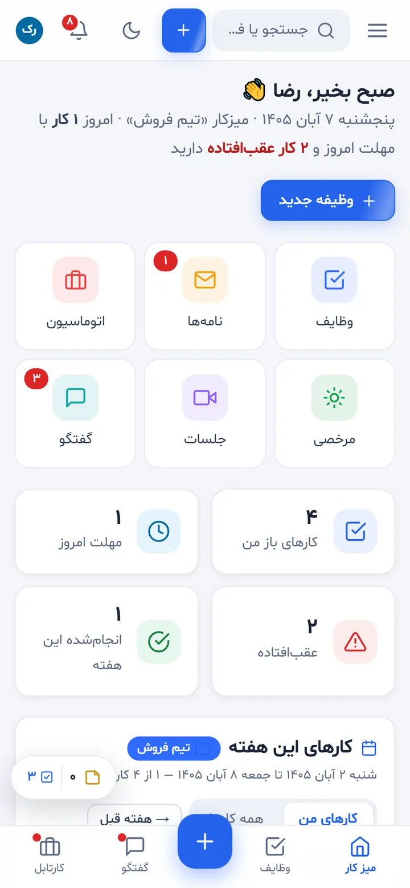
  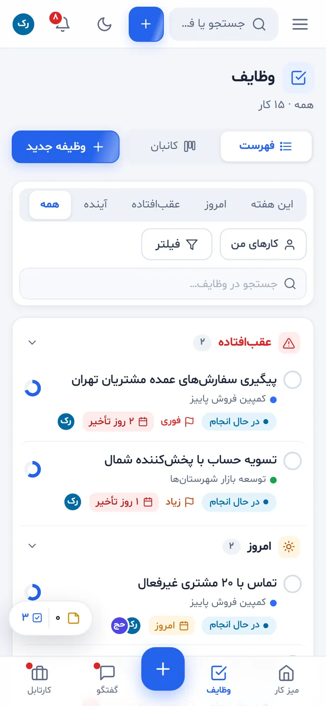
  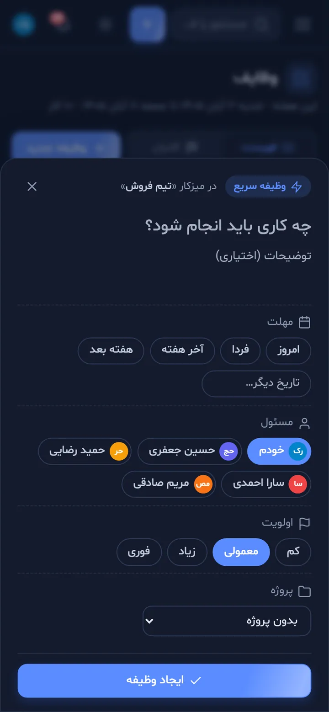

همه تصاویر در پوشه `assets/shots` هستند و با داده‌های ساختگی گرفته شده‌اند.

## فناوری

Python · FastAPI · SQLite · WebSocket · ربات بله · HTML/CSS/JS بدون فریم‌ورک سنگین

- آزموده با **۲۰۰ کاربر هم‌زمان** بدون خطا
- **۳۴۲ بررسی خودکار**

## انتشار با GitHub Pages

1. این پوشه را در یک مخزن تازه در گیت‌هاب بگذارید.
2. در مخزن به **Settings → Pages** بروید.
3. **Branch: main** و پوشه **/(root)** را انتخاب کنید و Save بزنید.
4. پس از یکی دو دقیقه، نشانی صفحه همان‌جا نمایش داده می‌شود.

## مجوز

- محتوای این مخزن (تصاویر، متن‌ها و صفحه نمایشی) متعلق به صاحب پروژه است و **همه حقوق آن محفوظ است**.
- فونت [شبنم](https://github.com/rastikerdar/shabnam-font) اثر صابر راستی‌کردار است و با مجوز SIL Open Font License 1.1 همراه آن آمده است (`assets/fonts/LICENSE`).

---

## English

**Kartabl** is a Persian (RTL) team workspace: tasks and projects, office automation with multi-step approvals, letters, leave requests, meetings, real-time chat, and an org chart. It also has a Bale messenger bot for notifications, approvals and one-time-code login.

This repository is a **showcase only**: screenshots plus an interactive landing page (`index.html`). **The application source code is not included.** All rights reserved.

The Shabnam font is © Saber Rastikerdar and is used under the SIL Open Font License 1.1 (see `assets/fonts/LICENSE`).
